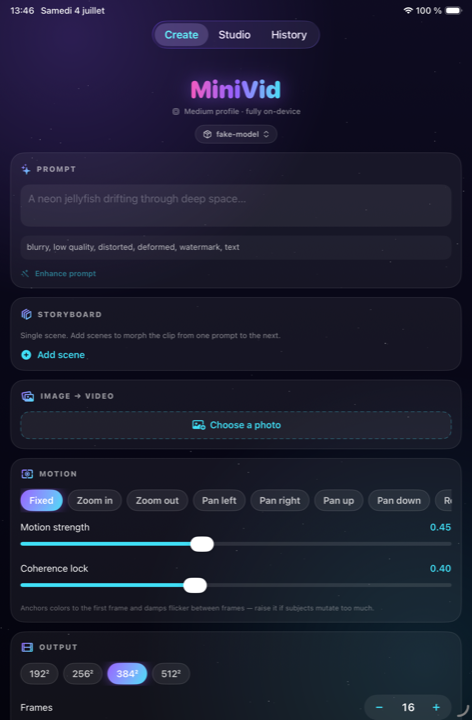
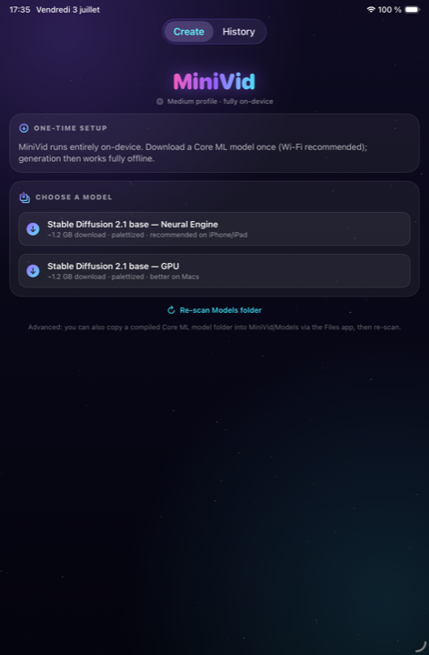
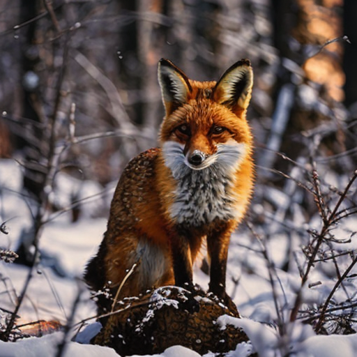

# MiniVid

**On-device AI video generation for iPhone, iPad and Apple Silicon Macs.**
No server, no API key, fully offline after a one-time model download.

Type a prompt (or start from a photo), pick a camera move, get a 2–4 s
stylized video clip with sound — generated entirely on the Neural Engine / GPU
of the device, including a 4 GB iPad mini 6.

*Status: v0.7 (July 2026) — text→video, image→video, multi-scene storyboard,
coherence stabilizer, camera control, prompt enhancer, procedural sound +
mini music composer + imported soundtracks + voiceover recording, Studio tab
(single-image generator, image resizer), in-app model manager, community
feed (share/watch/like clips), frame-blending smoothing, MP4/GIF export,
history.*

<p align="center">
  
  
</p>

## Problem statement

Every mainstream video generator (Sora, LTX-Video, Wan, Runway) assumes a
datacenter GPU. Nothing is designed from the start for the constraints of
Apple mobile silicon: ≤4 GB usable RAM, Neural-Engine-friendly ops, INT-quantized
weights. MiniVid targets exactly that gap: short stylized clips and animated
loops, generated locally, private by construction.

## How it actually works (honest architecture)

v0.1 does **not** train a custom video diffusion model — training a 100–500 M
parameter video DiT needs a GPU cluster and a large video dataset (that is the
v2.0 research track, see roadmap). Instead it implements the classic
**keyframe + img2img feedback loop** (Deforum-style) on top of Apple's official
Core ML Stable Diffusion port:

```
prompt ──► text2img (frame 0, 512²)   ◄── or img2img from a picked photo
              │                            (image→video, EXIF-baked, 512² crop)
              ▼
        camera transform          ◄── zoom / pan / rotate, per-frame
        (CoreGraphics affine)
              │
              ▼
        img2img @ motion strength ──► frame i  ──► loops N times
              │        (prompt switches per storyboard scene — the chain
              ▼         morphs from one scene to the next)
   downscale to export size ──► optional frame blending ×2/×4 (smoothing)
              │
              ▼
   silent MP4 (AVAssetWriter)
              │
              ▼ (if a sound style is selected)
   procedural soundscape (sine oscillators + noise, seeded) ──► PCM (.caf)
              │
              ▼
   AVMutableComposition mux ──► final MP4 with AAC audio (AVAssetExportSession)
```

- **Model**: [apple/coreml-stable-diffusion-2-1-base-palettized](https://huggingface.co/apple/coreml-stable-diffusion-2-1-base-palettized)
  (~6-bit palettized, ~1.2 GB download, `split_einsum_v2` variant runs on the
  Apple Neural Engine). Downloaded in-app on first launch, or dropped into the
  app's `Models` folder via the Files app.
- **Runtime**: [apple/ml-stable-diffusion](https://github.com/apple/ml-stable-diffusion)
  Swift package, `reduceMemory` mode on ≤8 GB devices (loads/unloads Core ML
  stages between pipeline phases).
- **Motion**: per-frame affine camera transform + img2img re-noising. Higher
  *motion strength* = more change between frames; the DPM-Solver++ scheduler
  keeps step counts low (10–15).
- **Coherence stabilizer**: Deforum-style color coherence — each frame's
  per-channel mean/std is pulled toward the first frame (or the I2V photo),
  plus a light temporal blend with the previous frame. Purely statistical,
  milliseconds per frame; the honest ceiling is that true identity
  preservation needs heavier ML (see roadmap).
- **Compute units**: Neural Engine on iPhone/iPad; GPU when running on a Mac
  as "Designed for iPad" — the Mac ANE rejects these iPad `split_einsum`
  programs (`ANEProgramProcessRequestDirect` error 0x16).
- **Sound**: fully procedural, not diffusion-generated — deterministic sine
  oscillators + seeded noise (mono, 22.05 kHz), synced to camera move and
  motion strength. No microphone, no recorded samples, no extra permission
  needed. Muxed into the MP4 via `AVMutableComposition` +
  `AVAssetExportSession`; GIF export stays silent (format limitation).
- **Entitlement**: `com.apple.developer.kernel.increased-memory-limit` for
  4 GB devices.

## Requirements

- Xcode 15+ on an Apple Silicon Mac
- [XcodeGen](https://github.com/yonaskolb/XcodeGen) (`brew install xcodegen`)
- Deployment target: iOS 17+ (iPhone, iPad; runs on Apple Silicon Macs as
  "Designed for iPad")

## Build & run

```bash
cd MiniVid
xcodegen generate          # produces MiniVid.xcodeproj (also committed)
open MiniVid.xcodeproj     # set your signing team, then Run on device
```

First launch: pick a model in the setup screen (~1.2 GB, Wi-Fi recommended).
First generation compiles the model for the Neural Engine — allow a few
minutes once; subsequent runs load from cache.

For the iOS Simulator or local inspection you can pre-download the model on
the Mac with `scripts/download_model.sh` (into `models/`, git-ignored).

## Community feed

The **Feed** tab is the one online feature of an otherwise fully offline app:
share a clip from the result screen or History, watch and like what others
posted. Backend: a Supabase table (`minivid_posts`) + public storage bucket,
guarded by row-level security. No accounts — a self-chosen handle, likes
deduplicated on-device. Uploads are capped at 25 MB, mp4/png only.

**The build ships no backend.** `SUPABASE_URL` and `SUPABASE_ANON_KEY` come from
`Secrets.xcconfig` (git-ignored — copy `Secrets.example.xcconfig`). Without them
the app builds, generates, exports and plays exactly the same; only the Feed tab
is off, and it says so.

Point it at *your own* project. An anon key is publishable only to the extent the
row-level-security policies behind it are known to be correct, which is a property
of that project and not of the key — so the policies are the thing to write and
review before turning this on. Anything published is visible to every user of the
app and moderation is manual, which suits a personal circle rather than a public
release.

## Bring your own model — sd-turbo conversion

The model manager accepts any compiled Core ML Stable Diffusion folder. The
repo ships a converter for **sd-turbo** (Stability's distilled SD 2.1 —
2–4 steps instead of 12, ~5× faster per frame, use the **Turbo** preset):

```bash
./scripts/convert_sd_turbo.sh   # ~30-60 min on an Apple Silicon Mac
```

It produces `build/minivid-sd-turbo_split_einsum_compiled[.zip]` in the exact
format of the downloadable models (6-bit palettized, Neural-Engine-ready).
Install: drop the folder into `MiniVid/Models` via the Files app (or into the
Mac app container), then *Re-scan Models folder*.

License note: sd-turbo weights are under the Stability AI **Non-Commercial
Research Community License** — fine for personal/portfolio use, not for a
commercial release.

Sample output of the converted model — **2 steps, ~0.6 s/step on an M-series
GPU** (seed 42, guidance 1.0):

<p align="center"></p>

## Device profiles

Detected from physical RAM at launch; caps frame count and picks defaults.

| Profile | Hardware example | Max frames | Default export | Expected time (16 frames, 12 steps) |
|---------|-----------------|-----------:|---------------:|-------------------------------------|
| Nano    | iPad mini 6, A15 (4 GB) | 24 | 256² | ~4–8 min |
| Small   | M1/M2 iPad, iPhone 15 Pro+ (6–8 GB) | 48 | 256² | ~2–4 min |
| Medium  | M-series Mac / iPad Pro (16 GB) | 64 | 384² | ~1–2 min |
| Large   | M4 Pro/Max Mac (24 GB+) | 128 | 512² | < 1 min |

Two levers cut render time without touching hardware limits: the **Draft
preset** (8 steps ≈ 35 % faster than Balanced) and **Smoothing** (frame
blending ×2/×4 — half the diffusion frames for the same output FPS).

Generation always runs at the model's native 512²; frames are downscaled to
the export resolution (192² / 256² / 384² / 512²).

## Controls

| Control | Range | Notes |
|---------|-------|-------|
| Prompt / negative prompt | free text | CLIP text encoder |
| Storyboard scenes | up to 4 prompts | equal frame shares, img2img chain morphs between scenes |
| Input image (I2V) | any photo | center-cropped to 512², drives frame 0 via img2img; saved as `input.png` in the project |
| Stylization (I2V) | 0.20–0.80 | how far frame 0 departs from the photo |
| Camera | fixed, zoom ±, pan ←→↑↓, rotate ±| applied between frames |
| Motion strength | 0.20–0.80 | img2img strength per frame |
| Coherence lock | 0.00–1.00 | color anchor + anti-flicker blend (see architecture) |
| Frames | 8–128 (device-capped) | diffusion keyframes |
| FPS | 8 / 10 / 12 / 16 | before smoothing |
| Smoothing | off / 2× / 4× | cross-dissolve in-betweens, multiplies output FPS free of diffusion cost |
| Quality preset | Draft / Balanced / Fine | 8 / 12 / 20 steps shortcuts |
| Steps | 6–30 | DPM-Solver++, 10–15 is plenty |
| Guidance | 1–15 | classifier-free guidance scale |
| Seed | optional UInt32 | reproducible runs (video and sound both) |
| Sound style | none / ambient pad / drifting drone / rhythmic pulse / mini melody / my audio | procedural & seeded, or an imported MP3/M4A/WAV trimmed to the clip |
| Sound volume | 0.10–1.00 | final peak level before muxing |
| Voiceover | record over the result | mixed on top, original soundtrack ducked to 50 % |

The **Studio tab** adds a single-image generator (same pipeline, output
reusable as I2V input) and an image resizer (square crop or fit-longest-side,
256–1024 px). The model pill under the title opens the model manager at any
time: switch, delete or download models without reinstalling.

Every generation is saved to History (config + seed + MP4 + thumbnail) and
reproducible from its seed.

## Project structure

```
MiniVid/
├── project.yml                  # XcodeGen manifest (SPM: ml-stable-diffusion, ZIPFoundation)
├── scripts/download_model.sh    # Mac-side model download helper
└── MiniVid/
    ├── MiniVidApp.swift         # entry point
    ├── AppModel.swift           # orchestration: load → generate → export → persist
    ├── Models/GenerationConfig.swift   # config, resolution modes, device profiles
    ├── Pipeline/VideoGenerator.swift   # keyframe + img2img loop (StableDiffusionPipeline)
    ├── Pipeline/CameraTransform.swift  # per-frame affine camera moves
    ├── Pipeline/ModelManager.swift     # HF download + unzip + discovery
    ├── Pipeline/AudioGenerator.swift   # procedural soundscape synthesis (seeded)
    ├── Export/VideoExporter.swift      # MP4 (AVAssetWriter), GIF/PNG (ImageIO)
    ├── Export/AudioComposer.swift      # PCM write + video/audio mux (AVAssetExportSession)
    ├── Storage/ProjectStore.swift      # JSON-indexed history in Documents
    └── Views/                          # SwiftUI: setup, form, progress, result, history
```

## Roadmap

- ~~v0.5 — image→video~~ **done**: PhotosPicker input drives frame 0.
  Storyboard (multi-prompt morphing) and procedural sound also landed early.
- **v1.0 — quality**: RIFE frame interpolation in Core ML (replacing the
  current cross-dissolve smoothing with real motion-aware in-betweens),
  prompt travelling (interpolated embeddings), LoRA styles, distilled UNet
  (SDXS/LCM class) for ~1 s/frame on A15.
- **v2.0 — research track**: the actual "MiniVid model" of the original spec —
  a compact spatio-temporal DiT (120–480 M params, 32×32 latents, INT4/INT8)
  distilled from an open video model. Needs GPU-cluster training; out of scope
  for an on-device repo.

## Acknowledgments & licenses

- [apple/ml-stable-diffusion](https://github.com/apple/ml-stable-diffusion) (MIT)
- Stable Diffusion 2.1 base weights: [CreativeML Open RAIL++-M](https://huggingface.co/stabilityai/stable-diffusion-2-1-base/blob/main/LICENSE-MODEL)
- [ZIPFoundation](https://github.com/weichsel/ZIPFoundation) (MIT)
- Animation technique inspired by the Deforum notebook lineage.
